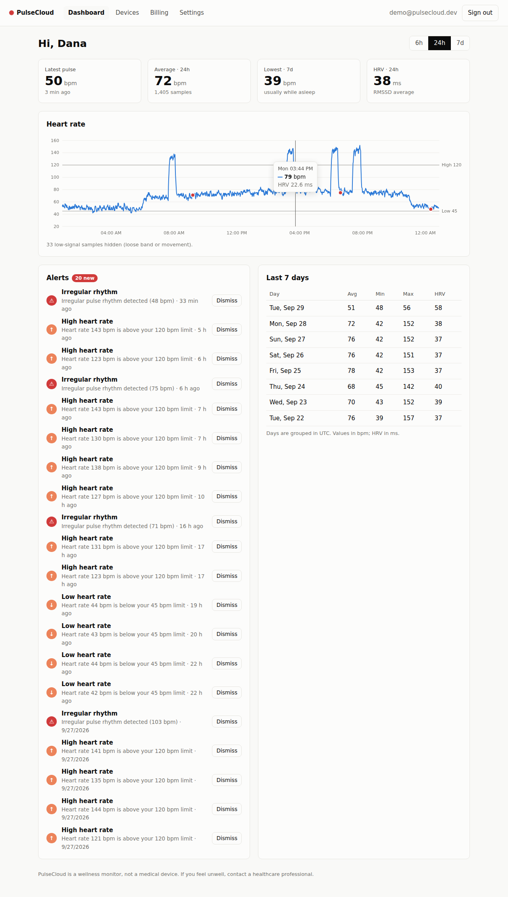

# PulseCloud — Customer Health Monitor (SaaS sample)

A sample SaaS app where customers wear a wrist pulse (PPG) band. The band uploads
heart-rate data to the cloud, and customers see their pulse history and alerts on a web
dashboard. Customers pay a **monthly subscription**.



## Architecture

```
 Wrist band / phone gateway            Cloud (FastAPI + Postgres)                Customer
 ─────────────────────────            ──────────────────────────                ────────
 PPG sensor ── 1 sample/min ──►  POST /api/v1/ingest  (X-Device-Key)
   bpm, HRV, signal quality,        │  • device key → customer
   irregular-rhythm flag            │  • active subscription? else 402
   (batched, retried)               │  • idempotent per (device, timestamp)
                                    │  • alert engine (thresholds, cooldown)
                                    ▼
                              pulse_readings / alerts  ◄── React dashboard (JWT)
                                    ▲                        charts, alerts, devices
 Stripe Checkout / Portal ── webhooks ─► subscriptions          billing, settings
```

| Part | Path | Tech |
|---|---|---|
| API | `backend/` | FastAPI, SQLAlchemy 2, Postgres (SQLite for dev), JWT, bcrypt, Stripe |
| Dashboard | `frontend/` | React 18 + TypeScript + Vite, hand-built SVG chart (no chart library) |
| Device simulator | `device-simulator/simulate.py` | Python stdlib only |
| Local stack | `docker-compose.yml` | Postgres + API + nginx-served dashboard |

## Features

- **Accounts:** email/password sign-up, JWT sessions, per-customer data isolation.
- **Monthly plans** (defined in `backend/app/plans.py`):

  | Plan | Price | Devices | History | Alerts |
  |---|---|---|---|---|
  | Basic | $9.99/mo | 1 | 30 days | High/low heart rate |
  | Pro | $19.99/mo | 5 | 12 months | + irregular rhythm |

- **Billing:** Stripe Checkout for new subscriptions. The Stripe Customer Portal handles
  plan changes, cards, and invoices. Webhooks keep the subscription status in sync
  (`active`, `past_due`, `canceled`, …). Without Stripe keys the app runs in **mock billing
  mode**, where choosing a plan activates it immediately, so the demo works offline.
- **Devices:** each wrist band gets its own API key. The key is shown once and only a
  SHA-256 hash is stored. Keys can be rotated or revoked, and device count is capped by plan.
- **Ingest:** batched uploads of up to 1,000 samples. Retries are safe because duplicate
  timestamps are skipped. Uploads are rejected with `402` when the subscription lapses.
- **Alerts:** heart rate above or below the customer's limits, and irregular rhythm on the
  Pro plan. There is a 15-minute cooldown per alert type. Samples with poor sensor contact
  (`signal_quality < 0.5`) are ignored.
- **Data retention:** `python -m app.jobs.purge` deletes readings older than the plan's
  history window. Run it daily.

## Run locally

### Option A — Docker Compose

```bash
cd health-monitor-saas
docker compose up --build
# Dashboard: http://localhost:8080   API docs: http://localhost:8000/docs
```

### Option B — dev servers

```bash
# API
cd health-monitor-saas/backend
python -m venv .venv && source .venv/bin/activate
pip install -r requirements.txt
uvicorn app.main:app --reload          # SQLite by default; http://localhost:8000/docs

# Dashboard (new terminal)
cd health-monitor-saas/frontend
npm install && npm run dev             # http://localhost:5173 (proxies /api to :8000)
```

### Try the full flow

1. Open the dashboard, create an account, and pick a plan on **Billing**.
2. Go to **Devices**, add a device, and copy its key.
3. Stream simulated wrist-pulse data:

   ```bash
   python device-simulator/simulate.py --key hm_... --backfill-hours 24 --interval 5
   ```

   This uploads 24 hours of history (including sleep, exercise bursts, loose-band noise,
   and occasional irregular beats), then streams one new sample every 5 seconds.

### Tests

```bash
cd backend && pytest
```

The tests cover auth, plan limits, mock checkout, ingest idempotency, alerts and
cooldowns, tenant isolation, retention, and signed Stripe webhooks.

## Enabling real Stripe payments

1. In Stripe (test mode), create a product with two **monthly recurring** prices: Basic and Pro.
2. Enable the Customer Portal (Settings → Billing → Customer portal) and allow plan switching.
3. Set these in `backend/.env` (see `.env.example`): `HM_STRIPE_SECRET_KEY`,
   `HM_STRIPE_PRICE_BASIC`, and `HM_STRIPE_PRICE_PRO`.
4. Forward webhooks and set `HM_STRIPE_WEBHOOK_SECRET` to the secret it prints:
   `stripe listen --forward-to localhost:8000/api/v1/billing/webhook`.

## Device API

```http
POST /api/v1/ingest
X-Device-Key: hm_...
Content-Type: application/json

{"readings": [
  {"recorded_at": "2026-09-29T08:15:00Z", "bpm": 72, "hrv_ms": 41.5,
   "signal_quality": 0.93, "irregular_rhythm": false}
]}
→ {"accepted": 1, "duplicates": 0, "alerts_created": 0}
```

## Before production

This is a sample. A real health product would also need the following:

- Alembic migrations instead of `create_all`, and a strong `HM_JWT_SECRET`.
- A time-series store for scale, such as TimescaleDB or Timestream, plus rate limiting on ingest.
- Email or push delivery for alerts, password reset, and email verification.
- HIPAA/GDPR work: encryption at rest, audit logs, a BAA with your cloud provider,
  data export and deletion, and consent.
- Secure device provisioning (per-device certificates or MQTT via AWS IoT Core / Azure IoT Hub).
- Regulatory review. Heart-rhythm features can make a product a medical device.
  PulseCloud presents itself as a wellness monitor.
